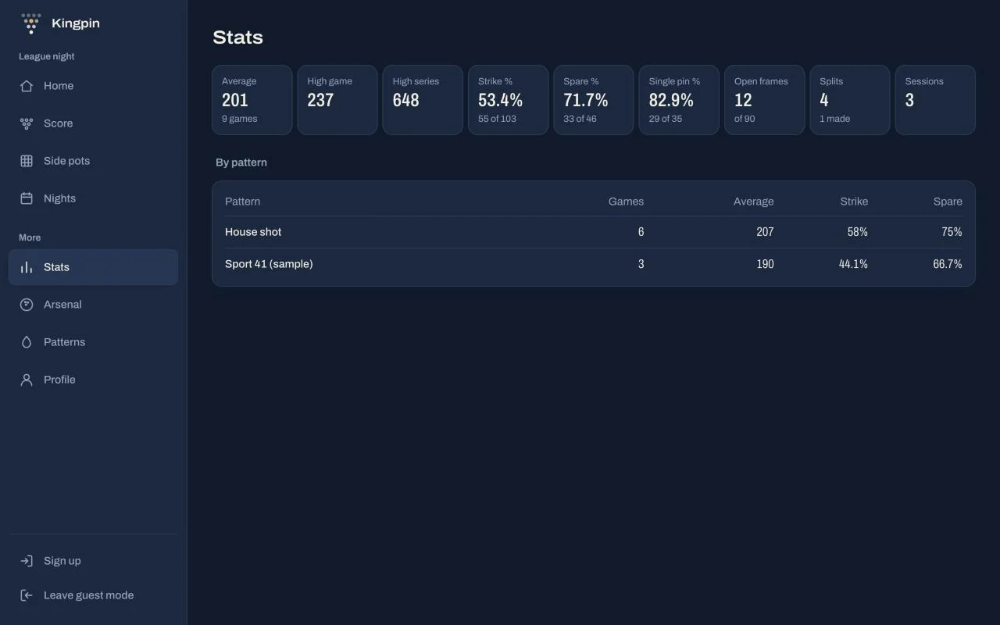
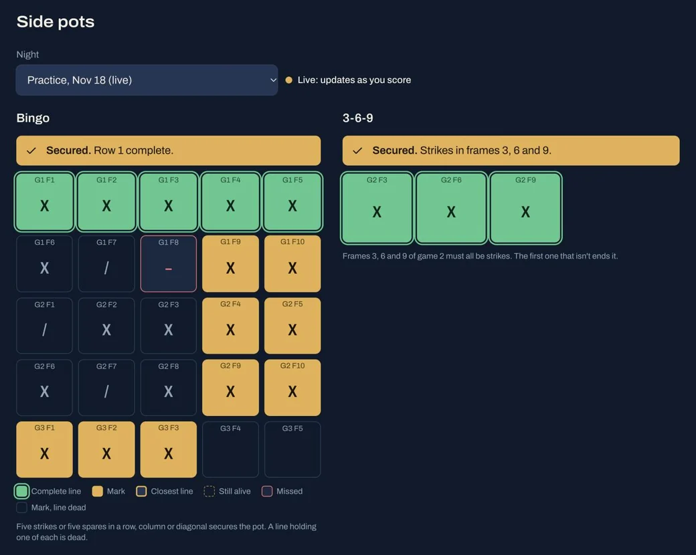

# Kingpin

A bowling league and practice tracker. Score games ball by ball, track the pins you leave, run live bingo and 3-6-9 side pots, and see your stats by oil pattern.

**Live app:** [bowling-tracker-one.vercel.app](https://bowling-tracker-one.vercel.app) · click **Try as guest** to use it with sample data, no account needed.



## Features

- **Ball-by-ball scoring.** Tap the pins left standing on a pin deck, or use Strike, Spare and Missed. Scores update frame by frame like an alley scoresheet.
- **Side pots.** A 5×5 bingo board built from the first 25 frames of the night, and 3-6-9 (strikes in frames 3, 6 and 9 of game 2). Both update live while you score.
- **Stats.** Average, high game and series, strike and spare percentages, single-pin spare conversion, open frames, splits, and a breakdown by oil pattern.
- **Arsenal and patterns.** Log your bowling balls with their layouts (2LS or dual-angle) and the oil patterns you bowl on.
- **League nights.** Nights grouped by league, with per-night scoresheets and a season view.
- **Guest mode.** Anyone can try the full app with sample nights. Nothing is saved until you sign up, and you can keep your guest games when you do.



## Tech stack

React 19 · TypeScript · Vite · Tailwind CSS v4 · Zustand · React Router · Supabase (auth and Postgres) · Vitest · deployed on Vercel

## How it's built

- **Offline first.** Every shot is saved on the device right away, because bowling alleys tend to have bad signal. Signed-in users are backed up to Supabase and stay in sync across devices.
- **Scoring is pure functions.** The scorer takes a flat list of pins knocked down per roll and returns frame totals. The store only records shots; scores are derived when the screen renders, so they can never drift out of sync.
- **Pins as a 10-bit bitmask.** Each shot stores which pins are still standing as one small integer (pin N is bit N-1). Leaves, splits and spare conversions are worked out from that.
- **Side pots are derived, not stored.** Bingo lines and 3-6-9 status are computed from the games every time, so editing a frame updates the pots automatically.
- **Row-level security.** Every table in the database only lets a signed-in user read and write their own rows.
- **Tested.** 313 Vitest tests across scoring, pins, side pots, stats, guest mode and sync.
- **Decisions are written down.** [DECISIONS.md](DECISIONS.md) records 42 design decisions, each with the alternatives considered and why.

## Run it locally

Requires Node 20.19 or newer.

```bash
npm install
npm run dev      # start the app at http://localhost:5173
npm test         # run the test suite
npm run build    # type-check and build for production
```

Without Supabase keys, the app runs signed out and saves to the browser only. To turn on accounts and sync:

1. Create a Supabase project and run [`supabase/schema.sql`](supabase/schema.sql) in its SQL editor.
2. Copy `.env.example` to `.env.local` and fill in your project URL and **publishable** key.

## Project structure

```
src/
  scoring/    pure scoring functions (frames, totals)
  pins/       pin bitmask helpers: leaves, splits, conversions
  sidepots/   bingo and 3-6-9 logic
  stats/      averages and percentages
  store/      Zustand store: sessions, shots, arsenal
  sync/       local storage and Supabase sync
  guest/      guest mode and sample data
  screens/    one file per page
  components/ shared UI: pin deck, scoresheet, nav
```

---

Built by [Edwin Alexander Vargas](https://edwinvargas.dev).
